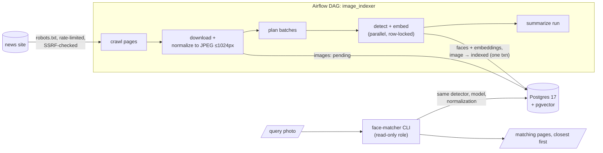
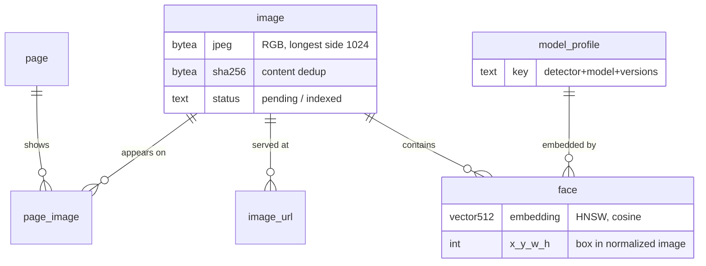
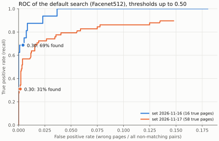
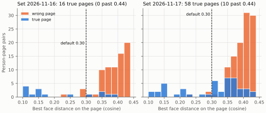

# photo-crawler

**Give it one photo of a person, and it finds every page of a news site that shows them.**

An Airflow pipeline crawls the site politely, normalizes every image, detects and embeds every face, and stores it all in Postgres + pgvector. A read-only CLI then searches that index with a new photo. It starts with one command, re-runs incrementally, and comes with a measured accuracy report. The report doesn't hide where the model falls short.

| | |
|---|---|
| **One command** | `docker compose up` builds and starts Airflow, Postgres + pgvector, generated secrets and cached model weights. No `.env`, no manual steps. |
| **Production habits** | Ports-and-adapters core, transactional indexing, idempotent re-runs, per-host rate limits, SSRF-safe fetching, and failures that are counted and surface as a failed run, never a quiet green one. |
| **Tested at four levels** | About 490 pytest tests (unit, Postgres integration, DAG, offline end-to-end smoke on a mock web), a real-model smoke test, and a full-stack smoke run. CI runs lint, types, tests, Compose validation and the label-set checks on every pull request. |
| **Measured, not guessed** | Two hand-labelled evaluation sets, a ROC curve, and a model comparison judged by a rule written down *before* the run. When ArcFace failed that rule on held-out data, the default stayed Facenet512. |

| Deliverable | Where |
|---|---|
| Airflow pipeline | [dags/image_indexer.py](dags/image_indexer.py) → logic in [src/face_index/](src/face_index/) |
| Face matching script | [src/face_index/face_matcher.py](src/face_index/face_matcher.py) (Compose service `face-matcher`) |
| Compose file | [docker-compose.yml](docker-compose.yml) |
| Accuracy evaluation | [scripts/evaluate_search.py](scripts/evaluate_search.py), [queries/eval/](queries/eval/), [docs/search-evaluation.md](docs/search-evaluation.md) |
| Operations (re-runs, re-index, dead links, tests) | [docs/operations.md](docs/operations.md) |

`specs/`, `.specify/` and `docs/briefs/` are design records (specs, plans, pre-registered experiment briefs). You don't need them to run or review the project.

## Architecture





The design decisions behind it:

- **The logic lives outside Airflow.** DAG tasks are thin wrappers over `face_index`, which depends only on interfaces (fetcher, pacer, normalizer, embedder, store). The whole pipeline runs offline in tests against fakes, and the orchestrator could be swapped out.
- **One database, one transaction per image.** Postgres holds pages, metadata, the normalized JPEGs, boxes and embeddings. An image becomes `indexed` in the same transaction that writes its faces, so the search never sees a half-indexed image. There's no Redis: the LocalExecutor needs no broker, and the per-host rate limit is a single Postgres row per host.
- **Download and detection are separate.** Downloads only stage images. Detection runs in parallel batches with row locks, so no image is processed twice and the slow model never holds up the crawl.
- **Incremental by URL and by content.** A known URL is never fetched again, and a new URL with an identical SHA-256 reuses the stored faces. The second run took 2 minutes, against 72 for the first.
- **A model-profile key on every face.** The detector, model and DeepFace/TensorFlow versions form a key. The search refuses to compare embeddings across keys, and a model change goes through an explicit, resumable re-index from the stored JPEGs, with nothing downloaded again.
- **Polite and safe crawling.** It obeys robots.txt, sends an honest User-Agent, checks every redirect hop before following it, refuses private addresses and pins connections to the checked IP, and caps downloads and decoded pixels. people.com refuses honest crawlers (HTTP 402) and its terms forbid scraping, so it is disabled, as agreed with the reviewer.
- **The database enforces the invariants.** CHECK constraints guarantee that every stored image is at most 1024 px, that a JPEG is kept only while an image is pending or indexed, that a page has at most one lead image, and that every embedding is 512-d. A bug can't quietly write a bad row.
- **Failures stay visible.** A bad page or image is logged, counted, and the run carries on. At the end the run is marked failed, so a failure is never shown green. A database or model outage fails the task outright, so Airflow retries it.
- **No secrets in git.** Passwords and the JWT secret are generated on first start. The pipeline writes as `faces_writer`; the search reads as `faces_reader`, which can only SELECT.

## How to run the pipeline

Needs Docker with Compose v2 and at least 8 GB of memory for Docker.

```bash
docker compose up -d --build --wait                                    # UI at http://localhost:8080
docker compose exec airflow-scheduler airflow dags trigger image_indexer
```

Every setting is optional:

```bash
docker compose exec airflow-scheduler airflow dags trigger image_indexer \
  --conf '{"depth": 1, "page_cap": null, "page_rate": 1.0, "image_rate": 5.0}'
```

| Param | Default | Meaning |
|---|---|---|
| `depth` | 1 | Link hops from the home page (0 = home page only) |
| `page_cap` | 50 | Most page requests per site; `null` = the whole site within `depth` |
| `page_rate` / `image_rate` | 1.0 / 5.0 | Requests per second, per host |
| `reindex` | false | Re-embed stored images after a model change ([operations](docs/operations.md#re-index-after-a-model-change)) |

**Coverage and time.** The default run covers 50 pages of CNN, not the whole site, so a first run finishes in a little over an hour on a laptop. On an Apple M-series machine with 8 GB for Docker, those 50 pages (about 4,700 images) took 72 minutes, mostly face detection on CPU. Use `page_cap: null` for the whole site; the time grows with the number of images. Raising `FACE_WORKERS` adds detection workers.

## How to use the face matching script

Put a photo in `queries/` (the folder is shared with the container and git-ignored), then run:

```bash
docker compose run --rm face-matcher queries/alice.jpg
docker compose run --rm face-matcher queries/alice.jpg --details      # distances and image URLs too
```

For each face in the photo, the script prints the pages whose images contain a face closer than the threshold, closest first. It uses exactly the index's detector, model and normalization, and only searches faces from the same model profile. A page that no longer shows the image is not returned.

| Option | Default | Meaning |
|---|---|---|
| `--threshold T` | 0.30 | Cosine distance below which a face matches. 0.30 is DeepFace's published value for Facenet512; lower is stricter |
| `--face N` | all | Search only face N |
| `--list-faces` | off | Number the faces and save an annotated copy, without searching |
| `--min-face PX` | 0 | Ignore indexed faces smaller than PX pixels (measured, not adopted) |

Exit codes are scriptable: `0` success (including no matches), `1` database or model unavailable, `2` bad photo, `3` no face in the photo, `4` index empty, `5` couldn't write the annotated copy, `64` usage error.

## Libraries and models

| Purpose | Choice | Why |
|---|---|---|
| Orchestration | Apache Airflow 3 (LocalExecutor) | Required; LocalExecutor keeps it to one machine with no broker |
| Face detection | DeepFace + RetinaFace (confidence ≥ 0.9) | Among the most accurate detectors DeepFace offers, which matters for small, angled news faces |
| Face embedding | DeepFace **Facenet512**, aligned, cosine | Strong published accuracy. ArcFace was tested and not confirmed (below) |
| Vector store | PostgreSQL 17 + pgvector (HNSW) | One database for metadata and vectors, with transactional consistency |
| Crawling and images | httpx, BeautifulSoup, Pillow | Manual redirects make every hop checkable |
| Tooling | uv, ruff, ty, pytest, GitHub Actions | Locked dependencies; lint and types enforced in CI |

## Example usage and expected outputs

First run on an empty index (`summarize` task log, 2026-11-11, CNN, 72 min):

```
pages crawled                           50
images found                          5575
downloaded                            4710
reused by URL                          862
newly indexed (with faces)            3034
analyzed, no faces                    1670
faces stored                          9346
failures                                 2
```

The two failures are people.com's HTTP 402 (recorded before the site was disabled) and one image that returned HTTP 500. The second run, straight after, downloaded 72 new images and took 2 min 10 s.

A search (`docker compose run --rm face-matcher queries/eval/photos/person-a.jpg --details`, on the 2026-11-17 index; image lists shortened):

```text
# face 1 x=249 y=116 w=191 h=299: 3 pages
0.132      https://edition.cnn.com/world
    image: https://media.cnn.com/api/v1/images/stellar/prod/gettyimages-2301763081.jpg?c=3x2&q=h_768,w_1152,c_fill/f_webp
    image: https://media.cnn.com/api/v1/images/stellar/prod/gettyimages-2301763081.jpg?c=1x1&q=h_768,w_768,c_fill/f_webp
    … 2 more image URLs
0.140      https://edition.cnn.com/world/middle-east
    image: https://media.cnn.com/api/v1/images/stellar/prod/gettyimages-2301763081.jpg?c=16x9&q=h_438,w_780,c_fill
    image: https://media.cnn.com/api/v1/images/stellar/prod/gettyimages-2301763081.jpg?c=16x9&q=h_810,w_1440,c_fill/f_webp
    … 9 more image URLs
0.140      https://edition.cnn.com/world/middleeast/israel
    image: https://media.cnn.com/api/v1/images/stellar/prod/gettyimages-2301763081.jpg?c=16x9&q=h_438,w_780,c_fill
    image: https://media.cnn.com/api/v1/images/stellar/prod/gettyimages-2301763081.jpg?c=16x9&q=h_810,w_1440,c_fill/f_webp
    … 10 more image URLs
```

All three are labelled pages for person-a in the 2026-11-17 set. Several URLs per page are different sizes of the same photo, which are stored as separate images by design.

## Search accuracy

The search is scored against two hand-labelled sets. Each is a CNN crawl with people who appear on it, labelled with every page they appear on, and people who don't, each with one openly licensed photo. The targets: find at least 80% of each person's pages, return no page without the person, and return nothing for absent people.

| Set | True pages found at 0.30 | Wrong pages, present people | Wrong pages, absent people | Verdict |
|---|---|---|---|---|
| 2026-11-16 (5 + 5 people) | 11 of 16 | **0** | 4 (2 of 5 people) | FAIL |
| 2026-11-17 (10 + 10 people, held out) | 18 of 58 | **0** | 3 (2 of 10 people) | FAIL |

**What this means.** When the search returns a page for someone who is on the site, it was right every time on both sets. That's the precision side of the assignment's "high confidence". The cost is recall: on the held-out set it finds about a third of each person's pages, and a close look-alike can pass.

<picture>
  <source media="(prefers-color-scheme: dark)" srcset="docs/img/roc-dark.svg">
  
</picture>

The default threshold sits far to the left of the curve: at under 0.5% false positives, recall is 69% on the first set and 31% on the held-out set. Over all pairs, the AUC is 0.994 and 0.913. Moving right buys recall quickly, but every step costs wrong pages.

<picture>
  <source media="(prefers-color-scheme: dark)" srcset="docs/img/distances-dark.svg">
  
</picture>

Here is why no threshold passes. True pages (blue) and wrong pages (orange) overlap between 0.30 and 0.40, and several misses sit just past the line (0.3002, 0.3008, 0.313). The threshold was not moved to make the table look better. Both figures are drawn from the committed logs by [scripts/plot_eval.py](scripts/plot_eval.py).

**What was tried, each judged by a rule fixed before the run:**

| Idea | Result | Decision |
|---|---|---|
| Face-size filter (40 px) | Same false matches, one true page lost | Off by default |
| Re-scoring: CSLS, T-norm, query expansion (12 combinations) | Worse in every combination | Not adopted |
| ArcFace instead of Facenet512 | Recall at zero false matches 0.88 against 0.62 on the first set; **no gain on the held-out set** (0.28 against 0.28, AUC 0.912 against 0.913) | Not confirmed, so the default stays Facenet512 |

The ArcFace result is the one to look at. On the first set, the best of 12 combinations looked like a clear win. A held-out set showed it was luck, plus labels built from the baseline's own matches. A pre-registered check is what stopped it from shipping.

**Limits.** The labels were partly built from Facenet512's own near matches, so they favour it. One person labelled every page. The sets are small (30 people). Full tables, distances and experiments are in [docs/search-evaluation.md](docs/search-evaluation.md).

**Next steps, by expected gain:**
1. **Several query photos per person.** Most misses are just past the threshold, which averaging tends to fix.
2. **ArcFace with its own input normalization.** The tested run used Facenet512's.
3. **Top-k search through the HNSW index.** The current query filters on distance, which scans every face. That's fine at 17k faces, but not at millions.

Each would be judged on a fresh label set.
